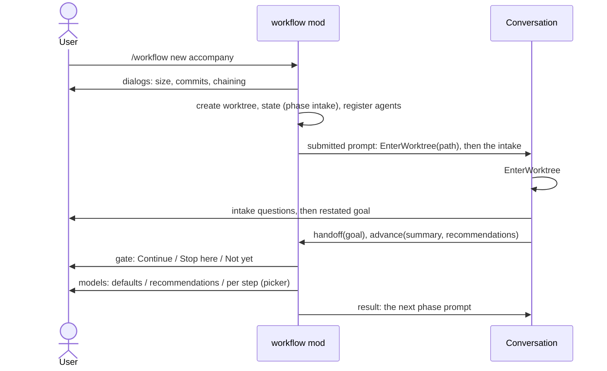
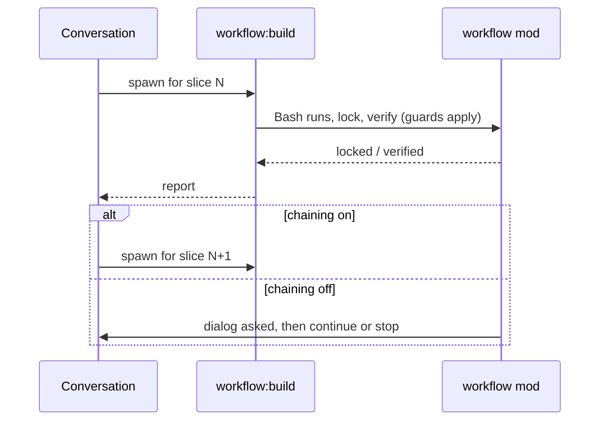

# accompagny: design

Keep these section names: slices name the sections they need, and the workflow mod hands exactly those to the build.

## Problem and acceptance criteria

After `/workflow new`, the user is left with an empty prompt. The session stays in the main checkout while the work happens in a new worktree, the goal is only the title, every phase ends with "type `/workflow next`", and nothing on screen says where the workflow stands. The mod knows the steps and enforces the rules, but the user has to drive a process that is meant to drive them. The goal: one `/workflow new` leads the user from the idea to a merged branch, asks them only what only they know, shows where they are at every moment, and runs the technical work in subagents on a model and effort chosen per step.

### Starting

- AC1. WHEN the user runs `/workflow new <title>` THE SYSTEM SHALL ask, in dialogs, the size (feature or project), whether to commit after each verified slice, and whether to start the next slice without asking.
- AC2. WHEN `/workflow new` created a worktree THE SYSTEM SHALL move the session into it and start the intake, with no further command typed by the user.
- AC3. WHEN the user runs `/workflow new` with no title THE SYSTEM SHALL ask for one instead of answering with the usage.

### Intake

- AC4. WHEN the intake runs THE SYSTEM SHALL ask the user the problem, the result wanted, how success will show, the limits and what is out of scope, then restate its understanding for the user to confirm.
- AC5. WHEN the user confirms the intake THE SYSTEM SHALL save the confirmed goal in the workflow state.

### Models and effort

- AC6. WHEN the intake is confirmed THE SYSTEM SHALL ask whether to use the default model and effort of each step or to change them.
- AC7. WHEN the user chooses to change them THE SYSTEM SHALL open a panel listing each step with a model picker, an effort picker, the default and Claude's recommendation for this workflow with its reason.
- AC8. IF the panel cannot be shown THEN THE SYSTEM SHALL ask one dialog per step instead.
- AC9. THE SYSTEM SHALL never offer Fable or `max` effort, and SHALL show a reason beside any `xhigh` recommendation.
- AC10. WHEN a step's work runs THE SYSTEM SHALL run it in a subagent on that step's chosen model and effort.
- AC11. IF Claude tries to change the model plan or slice chaining THEN THE SYSTEM SHALL refuse: only the user's answers in a dialog or the panel change them.

### Moving on

- AC12. WHEN the user approves a phase THE SYSTEM SHALL offer to continue now or stop here, and on continue SHALL start the next phase in the same conversation with no typed command.
- AC13. WHERE slice chaining is on WHEN a slice is verified THE SYSTEM SHALL start the next slice without asking.
- AC14. WHERE slice chaining is off WHEN a slice is verified THE SYSTEM SHALL ask in a dialog whether to start the next slice.
- AC15. WHEN `/workflow continue` resumes a stopped workflow THE SYSTEM SHALL start where it stopped, with the same banner and model plan.

### Asking the user

- AC16. WHEN a feature reaches its design phase THE SYSTEM SHALL offer to map the project first, and on yes SHALL add a Context section to `design.md`.
- AC17. WHILE a phase runs THE SYSTEM SHALL ask every decision the user owns through a dialog with a recommended option.

### Review loop

- AC18. WHILE the review reports a blocker or a major finding THE SYSTEM SHALL fix it test-first and review again, up to 3 rounds.
- AC19. IF a blocker or a major finding remains after 3 rounds THEN THE SYSTEM SHALL stop and ask the user how to go on.
- AC20. WHEN no blocker or major finding remains THE SYSTEM SHALL ask the user which minor findings to fix.

### Following along

- AC21. WHILE a workflow runs on the current branch THE SYSTEM SHALL show a banner above the prompt with the steps of this workflow in order and the current one in colour, without done markers.
- AC22. WHILE a workflow runs THE SYSTEM SHALL show on the banner's second line the current sub-step, the model and effort it runs on, and whether it waits for the user.
- AC23. WHILE a workflow runs THE SYSTEM SHALL show in the status line the step, the slice when building, the model, and working or waiting for you.
- AC24. WHEN a phase starts THE SYSTEM SHALL tell the user where they are, what the phase produces and what they will be asked, and SHALL end every turn with a "Next:" line saying whether the user has to act.

### Ending

- AC25. WHEN the pull request is opened AND the worktree has no uncommitted change AND the branch is pushed THE SYSTEM SHALL ask whether to remove the worktree and the local branch.
- AC26. IF the worktree has an uncommitted change or the branch is not pushed THEN THE SYSTEM SHALL keep both, say why, and ask again at `/workflow done`.
- AC27. WHEN the user agrees to the removal THE SYSTEM SHALL move the session back to the main checkout before removing the worktree.

## Drivers

1. **The user never has to know what to type next.** Every move is either automatic or one dialog answer.
2. **The gates stay with the user.** No phase moves without approval, a slice's tests stay locked, and Claude cannot change the model plan or slice chaining by itself. Subagents must not open a way around any of these.
3. **Plan usage.** The user is on a Pro plan: each subagent starts cold, so the split between conversation and subagents must save more than it costs.
4. **A small, testable mod.** The mod API is early access; everything new should be testable with `claude plugin test` and degrade to a working workflow when a UI piece cannot be shown.
5. **A readable conversation.** The conversation is where the user follows the pipeline; tool output and code belong in the subagents.

## Options

The structural decision is how the work of a step reaches a model other than the conversation's.

- **A. The conversation orchestrates, the mod registers one agent per step.** `$.agent.register` defines `workflow:map`, `workflow:setup`, `workflow:spec`, `workflow:design`, `workflow:slice`, `workflow:build` and `workflow:review`, each with the step's model and effort from the workflow's plan, its tools and a prompt built from the phase file. The conversation talks to the user (intake, questions, option choices, approvals) and hands each piece of work to the step's agent, which returns a summary, the files it wrote and its open questions. The mod registers the agents again whenever the plan changes.
- **B. The conversation orchestrates, generic agents get the model from a hook.** The conversation spawns `general-purpose` agents with prompts it writes; a `tool.call` hook on `Agent` sets the model and effort of the current step.
- **C. No subagents: one session switches model between phases.** The mod runs `/model` and `/effort` at each phase change, and the phases run in the conversation as today.

| Driver | A: registered step agents | B: generic agents and a hook | C: one session, model switch |
| --- | --- | --- | --- |
| 1. Nothing to type | Yes: the conversation spawns each step itself | Yes | Yes, if the mod can run `/model` (not verified) |
| 2. Gates hold | The lock and scope guards see a subagent's tool calls (`tool.call` fires for them, per the types); the agent's `tools` list leaves out `mcp__workflow__advance`, so only the conversation moves a phase | Same guards, but a generic agent keeps every tool, `advance` included | Unchanged from today |
| 3. Plan usage | A cold start per step, offset by a short, focused prompt and the cheaper model of most steps | A cold start per step, with a longer prompt Claude writes each time | No cold starts, but the conversation grows through every phase |
| 4. Small and testable | About 7 agent specs built from the phase files, and tests of their model and tools | One hook, the smallest code, but the prompts are not under test | Smallest, if `/model` can be run by a mod |
| 5. Readable conversation | Yes | Yes | No: code and tool output fill the conversation |
| Reversibility | Easy: phases keep working in the conversation if the agents are removed | Easy | Easy |

Recommendation: **A**. It is the only option where the step's prompt, tools, model and effort are all decided by the mod rather than by what Claude writes in the moment, which is what driver 2 asks for. B saves a little code but leaves `advance` reachable from a subagent and the prompts untested. C keeps everything in one conversation, which is what the user asked to leave behind.

Three smaller choices ride on it, each with a recommendation:

- **Intake as its own phase**, first in both sizes, writing no file: the banner shows it, its gate leads to the model question, and a resumed workflow knows whether it happened. The alternative, a section at the top of the first phase, cannot be resumed precisely.
- **The banner in the band above the prompt**, drawn with coloured text, plus one dim transcript line at each phase change for the history. The alternative, transcript lines only, cannot use colour (`$.ui.log` draws a dim row) and scrolls away.
- **Sub-steps reported through a small `mcp__workflow__progress` tool**, with the step number of the phase file; the mod names the build and inspect sub-steps itself from the lock, the checks and the review rounds. The alternative, deriving every sub-step from tool calls, would guess.

## Decision

Option A, chosen by the user on 2026-11-11: the conversation orchestrates and the mod registers one agent per step. B lost because a generic agent keeps every tool, `mcp__workflow__advance` included, and its prompt is whatever Claude writes in the moment, so neither is under test. C lost because code and tool output would fill the conversation the user follows, and a mod running `/model` is not verified. The three smaller choices follow the recommendations: intake as its own phase, the banner in the band above the prompt, sub-steps through `mcp__workflow__progress`. Other answers: `/workflow new` without a title fills the prompt box with `/workflow new `; the review loop stops after 3 rounds. ADR: [2026-11-11-workflow-steps-in-registered-agents](../../adr/2026-11-11-workflow-steps-in-registered-agents.md).

## Components

Everything lives in `mods/workflow`. New files are marked (new).

- **`src/state.ts`**: a new first phase `intake` in both sequences (`intake, design, slice, build, inspect` and `intake, spec, design, slice, build, inspect, retro`); setup, when the project needs it, comes right after the intake. New fields: the model plan, the current sub-step, the review round. `phaseAfter` takes whether setup is needed.
- **`src/plan.ts`** (new): the steps of a size (`map`, `setup`, `spec`, `design`, `slice`, `build`, `review`), the default plan, the allowed models (`haiku`, `sonnet`, `opus`) and efforts (`low`, `medium`, `high`, `xhigh`), parsing and rendering, and validation: Fable, `max` and an unknown value are refused, `xhigh` without a reason is refused.
- **`src/agents.ts`** (new): builds one `AgentSpec` per step of the workflow (`workflow:<step>`): model and effort from the plan, the prompt from the "Agent" section of the step's phase file plus the shared worker rules, and `disallowedTools` with `mcp__workflow__advance`, `mcp__workflow__handoff`, `mcp__workflow__progress` and `AskUserQuestion`, so an agent neither moves the workflow nor talks to the user. The review agent is read-only (`Read`, `Grep`, `Glob`, `Bash`), like `agents/reviewer.md`, whose prompt it reuses. Registered at `session.start`, after `/workflow new`, and after a plan change.
- **`phases/*.md`**: each phase file splits into `## With the user` (what the conversation does: questions, dialogs, which agent to spawn, the gate) and `## Agent` (the worker's instructions). The numbered steps of "With the user" are the sub-steps the banner names. New `phases/intake.md` (writes nothing). `inspect.md` gains the review loop (AC18 to AC20); `design.md` gains the project-map offer for a feature (AC16).
- **`src/phases.ts`** and **`src/guards.ts`**: a phase that lists no `writes` may write nothing. Today an empty scope allows everything, which would leave the intake unguarded.
- **`src/prompts.ts`**: a shared "Leading the user" section in every phase prompt (AC17, AC24): open with where the user is, what this phase produces and what they will be asked; every decision through AskUserQuestion with a recommended option; end every turn with a "Next:" line.
- **`src/commands.ts`**: `/workflow new` asks size, commits and chaining; with no title it fills the prompt box (`$.prompt.fill`); after creating a worktree it submits a prompt that asks Claude to call `EnterWorktree` with the path and then start the intake. New `/workflow models` reopens the picker. `/workflow done` runs the ending checks.
- **`src/tools.ts`**: `handoff` gains `goal`, accepted in the intake phase only. `advance` answers "Continue", "Stop here" or "Not yet"; on Continue its result carries the next phase prompt, so the conversation goes straight on. The intake's `advance` also takes Claude's model recommendations and asks the model question (AC6). New `progress` and `finish` tools.
- **`src/picker.tsx`** (new): the model picker pane, opened focused as a dialog: one row per step with a model `Select`, an effort `Select`, the default, and Claude's recommendation with its reason; buttons "Use these", "Reset to recommended" and "Cancel". When `$.ui.open` answers `isPlaced: false`, the same choice runs as one `$.ui.ask` per step (AC8).
- **`src/banner.tsx`** (new): draws the band above the prompt (AC21, AC22). Line 1: the workflow's steps in order, the current one bold and coloured, the others dim, no done markers. Line 2: the sub-step (`design 4/8: proposing options`), the model and effort of whoever does it, and "working" or "waiting for you". Working and waiting come from `prompt.submit` and `turn.complete`, and from the mod's own dialogs.
- **`src/status.ts`**: the status line becomes `workflow accompagny: build 2/5, opus medium, waiting for you` (AC23); a dim transcript line marks each phase change for the history.
- **`src/ending.ts`** (new): the removal checks (no uncommitted change, an upstream branch with nothing left to push), the dialog, and the removal (AC25 to AC27).

## Data model

The state file `.git/claude-workflow/<slug>.md` gains three frontmatter keys. A state file without them reads as the default plan, sub-step 0 and round 0, so open workflows keep working.

```yaml
models: [map sonnet medium, setup sonnet medium, spec opus high, design opus high, slice opus high, build opus medium, review opus high]
step: 3
review_round: 0
```

`phase` accepts `intake`. The `Goal` section is written by `handoff` during the intake. The log gains entries for a plan change, a review round and the ending.

Default plan, from the user's choices on 2026-11-11 and `choosing-model-and-effort`:

| Step | Model | Effort | Runs |
| --- | --- | --- | --- |
| intake | the conversation's | the conversation's | In the conversation |
| map (feature, on yes) | sonnet | medium | `workflow:map` |
| setup | sonnet | medium | `workflow:setup` |
| spec (project) | opus | high | Questions in the conversation, drafting in `workflow:spec` |
| design | opus | high | Questions and the option choice in the conversation, research and drafting in `workflow:design` |
| slice | opus | high | `workflow:slice` |
| build | opus | medium | `workflow:build`, one run per slice |
| review | opus | high | `workflow:review`, once per round; fixes by `workflow:build` |
| retro (project) | the conversation's | the conversation's | In the conversation |

## API contracts

Tools (`mcp__workflow__*`), each refused outside a workflow on the current branch:

- `handoff { stopped, next, questions?, paths?, goal? }`: `goal` only in the intake phase, else refused.
- `advance { summary, recommendations? }`: `recommendations` only on the intake's gate, a list of `{ step, model, effort, reason }` validated by `plan.ts`. Dialog: "Continue", "Stop here", "Not yet". Results: on Continue the next phase prompt, on Stop here an instruction to hand off and stop, on Not yet "ask what should change". On the intake's gate, Continue then asks "Which models?" with "Use the defaults", "Use Claude's recommendations" and "Choose per step", and the last opens the picker.
- `progress { step }`: a whole number within the current phase's steps; sets the banner's sub-step. Refused in build and inspect, whose sub-steps the mod sets itself.
- `finish {}`: the ending, once the session has left the worktree. Refused while the session's folder is inside the worktree.
- `lock`, `verify`, `unlock`: unchanged. After a verified slice, the result says to spawn `workflow:build` for slice N when chaining is on, or asks the chaining dialog when it is off.

Commands: `/workflow new [title]` (no title: fills the prompt box), `/workflow models` (the picker, for the workflow on this branch), `/workflow done [slug]` (runs the ending checks before closing). The rest are unchanged.

Agents: `workflow:map`, `workflow:setup`, `workflow:spec`, `workflow:design`, `workflow:slice`, `workflow:build`, `workflow:review`. Each ends its run with a report the conversation can use: what it did, the files it wrote, the checks it ran and their result, and its open questions for the user.

## Key flows

Starting:



A slice:



Inspect: the conversation spawns `workflow:review`; while its report holds a blocker or a major finding and the round is below 3, it spawns `workflow:build` to fix each one test-first, then `workflow:review` again. After 3 rounds with one left, it stops and asks. Then it asks which minors to fix (multiSelect), drafts the pull request, and the gate asks the push.

Ending: the conversation calls `ExitWorktree` with `keep`, then `finish`. The mod checks, asks, removes the worktree without forcing, and deletes the local branch only when it points at the same commit as its upstream.

## Security model

- **Who moves the workflow**: only the conversation, through `advance`, and only after the user's answer in the engine's dialog. Step agents have `advance`, `handoff` and `progress` withheld.
- **Who sets the model plan and chaining**: only the user, through dialogs and the picker the mod draws. No tool takes them, and the existing deny rule plus the guard on `.git/claude-workflow` keep Claude from editing the state file. A plan read from the state file is validated again: an unknown model or effort falls back to the default.
- **Guards in subagents**: the write scope and the test lock rely on `tool.call` firing for a subagent's calls, which the API types state; slice 1 proves it on a real run before anything builds on it.
- **Removing the worktree** deletes files: it needs a clean worktree, a pushed branch, the session outside the worktree and the user's yes in a dialog, checked again at removal time.
- **Untrusted input**: the picker's values and `recommendations` are checked against the allowed lists before they reach `$.agent.register`.

## Test strategy

Level: solo tool. Tests in `mods/workflow/tests/*.test.ts` against the engine kit's fake git and file system, one file per module:

- `state`: `intake`, `models`, `step` and `review_round` round-trip; an old state file reads with the defaults; the phase order with and without setup.
- `plan`: defaults; Fable, `max` and unknown values refused; `xhigh` needs a reason.
- `agents`: one spec per step with the plan's model and effort, the withheld tools, the read-only review agent.
- `tools`: `goal` refused outside the intake; the three gate answers; `progress` bounds; the chaining result after `verify`.
- `commands`: `new` without a title fills the prompt box; `new` from the main checkout submits the EnterWorktree prompt; `done` with a dirty or unpushed worktree keeps it.
- `guards`: a phase with no `writes` refuses every write.
- `picker` and `banner`: their render functions as pure functions of the state, if the kit cannot mount a pane.

The real thing, run in the session scratchpad and deleted afterwards: a subagent's Bash call fires the lock guard (slice 1), and the user runs one `/workflow new` in a scratch repo at the end, since headless runs cannot answer dialogs.

## Observability

A dim transcript line at each phase change and each review round, the state log (plan changes, rounds, the ending), and failures of `$.agent.register` or `$.ui.open` written to the debug log with the fallback taken.

## Rollout and rollback

The change takes effect when `feat/accompagny` is merged into main: mods reload from `~/.claude/mods`. Open workflows keep their phase; without the new keys they get the default plan. Rollback: revert the merge commit. The state files stay readable by the old mod, except one left in `intake`, which the old mod cannot parse: move it to its next phase by hand.

## Risks

- **A dialog from a subagent's tool call** (`unlock`, a refused lock) might not show while a subagent runs. Medium likelihood, high impact on the build. Retired by slice 1, with the build agent run in the foreground; fallback: the build stays in the conversation.
- **Subagents cannot reach `mcp__workflow__*`**. Low likelihood (the tools are the session's), high impact. Retired by slice 1.
- **The pane API behaves unlike its types**. Medium likelihood, low impact thanks to the dialog fallback (AC8).
- **Cold starts on a Pro plan**: a subagent per step and per slice rereads its context. Medium likelihood, medium impact. Mitigated by short agent prompts that name the exact documents to read.
- **Claude does not call `EnterWorktree` from the submitted prompt** (a refused permission, say). Low likelihood, low impact: the reply still names the worktree and `/workflow continue`.
- **The engine kit may not mount panes or bands**. Medium likelihood, low impact: render functions are tested as pure functions, the rest in the final manual run.

## What changed from the design
